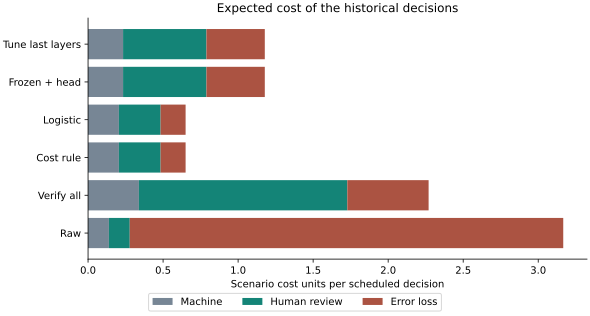

# MSBD 5017 · Curve 3pool 链上核验与人工介入成本

本项目研究两个问题。带有原始链上证据的报告能交付多少正确且可复算的结论？面对一项已生成的研究判断，系统应直接采用、追加核验，还是交给人工？

[技术报告（基线）](MSBD5017_Final_Project_Report.pdf) · [证据与覆盖率图表](audit/effect_metrics/README.md) · [成本实验与模型](decision_cost/README.md)

## 主要结果

| 实验 | 观测结果 |
| --- | --- |
| 正式 G/E 对照 | 两个历史窗口、六题、36 次预定模型运行。正确且可复算的组件为普通提示 **34/48**、证据引导 **43/48**。只看双方完成的配对，则为 **34/43** 与 **39/43**。 |
| 独立算术核验 | 在 6 个模拟共享算术缺陷中，新增独立检查把错误发布从 **6/6** 降至 **0/6**，**6/6** 个正确对照仍获发布。 |
| 核验和人工介入回放 | 对 36 次历史研究判断采用全量核验，自动错误从 **1** 降至 **0**，转人工从 **1** 增至 **10**。 |

## 什么时候值得追加核验

设定相同的取数和生成开支，逐次累计核验、人工、错误损失和风险模型的推理及训练摊销。在默认情景下，核验拦下的那一次错误若价值超过 **52.2 个成本单位**，全量核验即可抵消新增成本，前提是人工总能作对。按设置的人工残余错误率和各任务的损失计入剩余风险，临界点为 **67.7**。

| 策略 | 转人工／36 | 自动错误 | 每次平均情景成本 |
| --- | ---: | ---: | ---: |
| 原流程 | 1 | 1 | 3.17 |
| 全量核验 | 10 | 0 | 2.27 |
| 按风险和成本选择动作 | 2 | 0 | 0.65 |
| 逻辑回归 | 2 | 0 | 0.65 |
| 冻结编码器并训练分类头 | 4 | 0 | 1.18 |
| 同时微调末个编码层与分类头 | 4 | 0 | 1.18 |

成本单价、人工复核时长和错误损失是可修改的情景假设。临界点对应这批已回放判断。原始自动判断只有 1 次错误，模型比较按事件留出，属于开发评估。新增独立窗口已完成双源采集，等待九项参考的独立人工核对，正式模型运行数为零。[策略与口径](decision_cost/README.md) · [逐项成本](decision_cost/results/policy-trace.csv) · [35 组成本情景](decision_cost/results/sensitivity.svg)



## 证据与核验流程

历史数据来自 Alchemy 和 dRPC 的 Curve 3pool 快照，覆盖 2023 年 3 月 USDC 脱锚及 2022 年 11 月 FTX 窗口。两组用相同题目、资源预算及证据范围。V1 按主来源重算，V2 加入第二来源核对。发布器检查主张间的依赖，对指定的余额指标增加独立精确算术。历史报价附加实验取 50 个点，比较小额交易外推与目标规模合约报价。系统使用历史报价和研究判断来衡量效果。[基线范围与证据](LIMITATIONS.md) · [报告勘误](REPORT_ERRATA.md)

## 离线复现

在克隆仓库后，用两个公开 ZIP 中的文件复现。旧基线保留自身清单和校验值，新成本包包含分析代码、结果、双源确认窗口回执和数据准备程序。命令使用 Python 3.10 或更新版本，安装依赖后回放无需 API 凭证。

```sh
unzip MSBD5017_Public_Handoff.zip
mv MSBD5017_Public_Handoff baseline
unzip MSBD5017_Decision_Cost.zip
python3 -B baseline/docs/verify_delivery.py baseline
python3 -m pip install -r decision_cost/requirements.txt
python3 -B decision_cost/evaluation.py --output /tmp/5017-cost-replayed
```

通过基线入口复现正式归档和初版效果图。两个输出目录需使用新路径。

```sh
cd baseline
python3 -B -m curve_audit replay
python3 -B audit/effect_metrics/build.py --metrics-only --output /tmp/5017-effect-metrics
```

[基线 ZIP](MSBD5017_Public_Handoff.zip) · [基线 SHA-256](SHA256SUMS.txt) · [新增成本实验 ZIP](MSBD5017_Decision_Cost.zip) · [成本实验 SHA-256](DECISION_COST_SHA256SUMS.txt)
